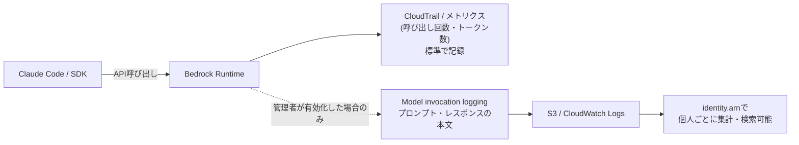
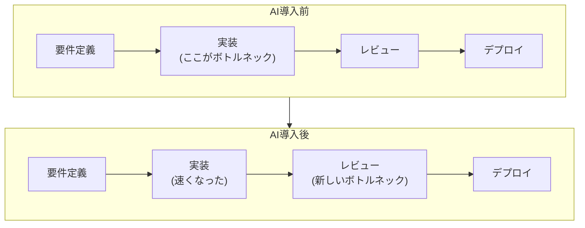

## TL;DR

- Model invocation logging を有効にすれば、プロンプトとレスポンスの本文が個人単位で残る。初期状態では無効だが、有効かどうかを使う側(開発者)は確認できない
- 過程を監視するツール自体は AI 以前からあった(bossware・WakaTime)。AI は新しいデータ源を足しただけ
- Meta では実際に反発と譲歩が起きている。一方 Meta・Microsoft・Google・Nvidia は個人単位の AI 利用状況を人事評価に組み込み始めている。絵空事ではない
- 仮に見えていても、AI の利用量やトークン消費量は生産性の指標としてほぼ機能しない。スクラムのベロシティが上がらないのも、たぶん同じ話
- 見えるかどうか分からない不安は、自分の会社に聞けば大体解消する

## きっかけ

最近 Amazon Bedrock 経由で Claude を使うことが増えたが、コミット数やマージ時間しか見なかった従来の生産性ツールと違って、どうやら成果物じゃなくそこに至る過程まで把握できるらしい。

個人的には細かく監視されるのはマイクロマネジメントっぽくて得意ではない。しかも、会社が実際にそこまで踏み込んだ記録を取っているかどうか、こっちからは確認しようがない。見られているかもしれない、じゃなくて、見られているかどうかすら分からない。

「Claudeの利用ログって、どこまで会社に見えてるんだろう」。それが気になって、実際に調べてみた。

## 技術的にどこまで見えるのか

全体の流れを図にすると、こうなる。



ポイントは2段階になっていることだ。何もしなくても残るものと、管理者が有効にして初めて残るものが、はっきり分かれている。

|                          | 何もしなければ    | Model invocation logging を有効にすると |
| ------------------------ | ----------------- | --------------------------------------- |
| 呼び出し回数・レイテンシ | 記録される        | 記録される                              |
| トークン数               | 記録される        | 記録される                              |
| プロンプトの本文         | 見えない          | そのまま残る(最大100KB)                 |
| レスポンスの本文         | 見えない          | そのまま残る(最大100KB)                 |
| 呼び出した人(IAMロール)  | CloudTrail に残る | ログに自動で付く(`identity.arn`)        |

左の列は量の話でしかないが、右の列は中身の話になる。

### 何もしなければ量しか残らない

`InvokeModel` / `Converse` といった API 呼び出しは CloudTrail に自動で残るし、Bedrock のメトリクスダッシュボードでもトークン数などが見られる。ただしここまでは量の話で、何を聞いたか・何を返してきたかは分からない。

### 有効にすると中身がそのまま残る

Model invocation logging はこの機能自体が最初は無効になっている[^1]。管理者が有効にすることで、以下のようなことが起きる。公式ドキュメントには、何が記録されるかがそのまま書いてある。

> invocation logging を使うと、アカウント内で行われたすべての呼び出しについて、リクエストの本文・レスポンスの本文・メタデータをまるごと収集できる。[^1]

実際のログはこんな形で残る。

```json
{
  "identity": { "arn": "arn:aws:sts::123456789012:assumed-role/DevRole/taro" },
  "input": {
    "inputBodyJson": { "messages": [{ "role": "user", "content": "..." }] },
    "inputTokenCount": 128
  },
  "output": {
    "outputBodyJson": { "content": [{ "text": "..." }] },
    "outputTokenCount": 512
  }
}
```

`inputBodyJson` が送ったプロンプトそのもの、`outputBodyJson` が返ってきた答えそのものだ。どちらも最大100KBまでそのまま記録され、超えた分は S3 に個別保存される。しかも `identity` を見れば、どの IAM ロール・どのセッションが呼び出したかが自動で分かる。

公式ドキュメントには、このログを CloudWatch Logs Insights で集計するクエリ例まで載っている。

```
fields identity.arn as principal,
       input.inputTokenCount as inTokens,
       output.outputTokenCount as outTokens
| stats sum(inTokens) as totalInput,
        sum(outTokens) as totalOutput,
        count() as calls
        by principal
| sort totalInput desc
```

このクエリ自体は個人ごとのトークン量を集計するだけのものだが、同じログには本文そのものも入っているので、量を見るのと同じ手間で中身を個人単位で読むこともできる。無効が初期状態という歯止めはあるが、有効化さえされれば、個人のプロンプト内容を追いかける仕組みは Bedrock 標準機能だけで完成する。外部ツールを別に用意する必要すらない。

## 似たような事例を探してみた

技術的に見えることは分かった。次に気になるのは、実際にそこまでやってる会社があるのか、という点だ。

正直、Model invocation logging を有効にしてる現場は、マイクロマネジメントみたいで苦手だ。この機能をそのまま使って監視してる実名の事例は見つからなかったが、似たような事例はいくつかあった。

### 過程を監視するツール自体は AI 以前からあった

Bedrock が特別なわけではなく、業務中の過程を監視するツール自体は AI 以前から存在した。

海外には「bossware」と呼ばれる製品カテゴリがある。キーストロークの記録(削除した入力まで残る)、画面キャプチャ、行動分析などをこなす製品が含まれる[^5]。コロナ禍のリモートワーク普及で一気に広まったとされ、市場規模の推計は調査会社によって幅があるが、10億ドル規模で、年10%前後の成長率という報告が複数ある。具体的な製品名も挙がっている。

| ツール                                  | 対象         | できること                                                |
| --------------------------------------- | ------------ | --------------------------------------------------------- |
| [Hubstaff](https://hubstaff.com/)       | 従業員 | 稼働時間・アプリ/URL利用状況の追跡、任意でのスクリーンショット |
| [Teramind](https://www.teramind.co/)    | 従業員 | 行動分析・インサイダー脅威の検知                          |
| [ActivTrak](https://www.activtrak.com/) | 従業員 | 生産性スコアリング・アプリ利用状況の可視化                |
| [WakaTime](https://wakatime.com/)       | 開発者       | エディタ上の作業時間、AI エージェント利用コストの内訳表示 |

WakaTime は開発者向けの作業時間トラッキングツールで、利用者数はすでに50万人超だ[^6]。このツール自体が、AI エージェントごとの利用コストを開発者単位で内訳表示する機能をすでに追加している。過程を監視することと AI の利用を監視することは、もう同じツールの中で合流し始めている。

### Meta の社内 AI 監視プログラム

実際にやってみたらどうなったか、具体例を見てみる。一番分かりやすいのが Meta の Model Capability Initiative(MCI)だ。

https://www.hrgrapevine.com/us/content/article/2026-06-01-meta-faces-employee-backlash-over-ai-tracking-tool-as-privacy-concerns-grow

AI エージェントを訓練する目的で、従業員の PC 操作を記録するプログラムだった。稼働時間の計測どころか、コードの変更履歴、PC のスリープ/起床サイクル、クリップボードにコピーした URL まで対象になっていたという。

https://www.inc.com/kit-eaton/metas-ai-experiment-shows-why-monitoring-employees-backfires-especially-with-gen-z/

従業員からは、監視ソフトが自宅のインターネット回線を圧迫し、月間データ容量を数日で使い切ったという苦情まで出た。数週間の反発を受けて、Meta は最大30分間データ収集を止められる機能と、プログラムからの適用除外を申請できる仕組みを追加して譲歩している。この記事は特に Z 世代の従業員でこの種の反発が強いと指摘していた。スリープ/起床サイクルまで見られていたとは。

### 人事評価に組み込む動きも広がっている

Meta の MCI は反発を受けて後退したが、個人単位の AI 利用状況をそのまま人事評価に組み込む動きは、むしろ広がっている。

Shopify の CEO Tobi Lütke は2025年4月、「AI で出来ないことを説明できない限り、追加の人員は認めない」という方針を打ち出した。

https://www.herohunt.ai/blog/tech-layoffs-and-ai-the-2026-reality-check

この方針は8ヶ月のうちに Meta・Microsoft・Google・Nvidia にも広がったという。

Meta は「Checkpoint」という、ソフトウェアエンジニア1人あたり200以上のデータポイントを集計する AI パフォーマンストラッカーを導入している[^9]。AI ツールでどれだけコードを生成したか、エラー率、バグ数、AI を使わずに書いたコード量、といった項目が含まれるという。個人単位・内容レベルでの追跡が、パフォーマンス評価にそのまま組み込まれた実例だ。

個人単位で AI 利用状況を追跡し、それを人事評価へそのまま組み込むことに、会社としては"成功"した例は、たしかにある。それを歓迎できるかどうかは、正直分からない。会社にとっての「うまくいってる」は、従業員にとっての「うまくいってる」と同じとは限らない。

なぜ歓迎できないと感じるのか、裏付けになりそうな研究もある。Cornell University の研究では、AI によるアルゴリズム的な監視が、従来型の監視より強い不満と抵抗を引き起こすことが確認されている。

> アルゴリズムによる監視を受けた参加者は、自分の自律性が下がったと感じ、不満を漏らす・パフォーマンスが落ちる・離職を検討するといった抵抗行動を、より多く取るようになった。[^2]

技術的に見えること、実際にそれをやってる会社があること、ここまでは確認できた。残る問いは1つ、その数字は本当に正しいのか、という点だ。

## 見えていたとしても正しく評価されるのか

仮に会社にログが見えていたとして、そこから自分の働きぶりを正しく判断できるのか、という問題がある。見えないところで評価されるのが怖いなら、見えたところで正しく評価されるとは限らない、というのも同じくらい怖い話だと思う。

### 「tokenmaxxing」というすでに名前のついた失敗パターン

DORA(Google が主導する DevOps 生産性の研究プロジェクト)は、トークン消費量を成果指標として扱う動きに、すでに名前をつけて警告している[^3]。「tokenmaxxing」と呼ばれるこれは、生のトークン消費量を社内ランキングで見せて AI 活用を煽る組織が実際に出てきていることを指す。

トークン消費量は「入力量」の指標でしかなく、コミット数や行数と同じで水増しが簡単な虚栄指標(vanity metric)だとされる。GitClear の調査も同じ方向を向いている。

https://www.gitclear.com/ai_assistant_code_quality_2025_research

GitClear は、Google・Microsoft・Meta を含む企業のリポジトリから、コードを行単位で誰が書いたかに紐づけて分析するプロダクトだ。2020年から2024年にかけての2億1,100万行を分析したこの調査では、AI 導入が進むほどリファクタリングの比率は2021年の25%から2024年には10%未満に下がり、コードの重複は8.3%から12.3%へと増え、コードチャーン(書いてすぐ書き直される割合)も上がっていた。量は増えたが、質は別の方向に動いていたことになる。

### スクラムのベロシティが上がらないのもたぶん同じ話

「Claude を入れてもスクラムのベロシティが上がらない」という話は現場でよく聞くが、これも同じ構造で説明できそうだ。



まず、ボトルネックが実装からレビューへ移動しただけという可能性が大きい。エンジニアリング分析企業 Faros AI が1,255チーム・1万人超の開発者のテレメトリを分析したところ、AI 活用度の高いチームはタスク完了数が21%増え、PR マージ数も98%増えていた。ただしその裏で PR レビュー時間は91%増加、PR サイズは154%増加していた[^7]。AI がコード生成を速くしても、制約(ボトルネック)は単に下流のレビューへ動くだけで、ボトルネックでない工程をいくら速くしてもシステム全体のスループットは変わらない。ゴールドラットの制約理論そのままの構図で、この現象には「AI 生産性パラドックス」という名前まで付いている。個人の生産性は上がっても、組織レベルの DORA メトリクス(デプロイ頻度・リードタイムなど)は横ばいのままだという。

検証コストが想定より重い、という理由もありそうだ。Lightrun の「State of AI-Powered Engineering 2026」によれば、AI 生成コードの43%が QA・ステージング通過後も本番で手動デバッグを必要としており、88%の組織が AI 生成の修正1件を確認するのに2〜3回の手動再デプロイを要している[^8]。コードを書く時間で浮いた分が、検証コストの増加でほぼ相殺されている構図だ。

そもそもコーディングがボトルネックでない現場も多い。意思決定の遅れや要件の曖昧さ、承認プロセスの長さが実装やテストより時間を食っているなら、AI がどれだけ実装を速くしてもスプリントのスループットには響かない。

ベロシティという指標自体の妥当性も怪しい。ストーリーポイントは「1ポイント=このくらいの人間の工数」という前提の上に乗っている相対指標なので、AI がその前提を崩してしまえば、数字が跳ね上がったところで実際の価値提供が増えた証拠にはならない。

### 本人の体感すら当てにならない

AI 安全性の研究機関 METR が2025年に発表したランダム化比較試験がある。経験豊富なオープンソース開発者16名に、主に Claude 3.5/3.7 Sonnet を組み込んだツールを使わせて計測したものだ[^4]。結果、実際にはタスク完了までに19%多く時間がかかっていたのに、本人たちは20%速くなったと体感していた。体感と実態の間に、約39ポイントの差があったことになる。

仮にトークン消費量やベロシティが生産性と綺麗に相関する指標だったとする。それでも、それを見て速い/遅いを判断する人間側の感覚は、すでにズレている可能性が高い。

数値を見えるようにして起きるのは、生産性が正しく見えるようになることではない。不正確な数字をもとに、それっぽい判断ばかり下されるようになることの方だろう。見えないより、間違って見える方が厄介な気もする。

## どう運用するのが良いのか

ここまで怖い話ばかり並べたが、AI 利用状況を計測すること自体が常に悪いわけではない。ここまで見てきた事例や研究を踏まえると、次のような運用ができているかどうかが分かれ目になりそうだ。

- 個人評価には使わないと、導入前に言っておく
- 計測の目的は「開発体験・品質の理解」に絞り、成果の代理指標にしない
- 監視される側にも、コーチングのような形で何か返す

技術的にできることだけが先に進んで、実際にどう使うかが決まっていないと、Meta のような反発を招く。しかもその数値自体、tokenmaxxing や METR の研究が示す通り、生産性を正しく反映しているとは限らない。技術より、運用と説明責任、そして測ろうとしているものが本当に測れているのかという謙虚さの方が大事なんだと思う。

冒頭で書いた「見られているかどうかすら分からない」という話については、会社の運用方針を待つだけでなく、自分で埋められる部分もある。Model invocation logging は初期状態が無効の機能で、有効かどうかは組織の設定次第だ。自分の会社で有効になっているかどうかは、情報システム部門やセキュリティ担当に聞けば大体分かる。見えないまま不安を抱えているより、先に確認してしまう方が気は楽になるかもしれない。

[^1]: 出典: [Monitor model invocation using CloudWatch Logs and Amazon S3](https://docs.aws.amazon.com/bedrock/latest/userguide/model-invocation-logging.html)(AWS 公式ドキュメント、意訳)

[^2]: 出典: [AI Surveillance in the Workplace Linked to Employee Resistance, Turnover](https://www.shrm.org/topics-tools/news/employee-relations/ai-surveillance-in-the-workplace-linked-to-employee-resistance--)(意訳)

[^3]: 出典: [DORA: Finding balance in the era of tokenmaxxing](https://dora.dev/insights/finding-balance-in-the-era-of-tokenmaxxing/)(意訳)

[^4]: 出典: [METR: Measuring the Impact of Early-2025 AI on Experienced Open-Source Developer Productivity](https://metr.org/blog/2025-07-10-early-2025-ai-experienced-os-dev-study/)

[^5]: 出典: [What is bossware? Are you being monitored at work?](https://www.comparitech.com/blog/information-security/what-is-bossware/)(意訳)

[^6]: 出典: [WakaTime公式サイト](https://wakatime.com/)

[^7]: 出典: [Your devs are faster with AI. Your team might not be.](https://dev.to/viniciosneves/your-devs-are-faster-with-ai-your-team-might-not-be-mc5)(Faros AI のテレメトリ分析を紹介した記事、意訳)

[^8]: 出典: [The State of AI-Powered Engineering 2026(Lightrun)](https://lightrun.com/ebooks/state-of-ai-powered-engineering-2026/)(意訳)

[^9]: 出典: [Meta links employee AI usage to performance reviews & rewards](https://www.hrgrapevine.com/us/content/article/2026-02-05-meta-links-ai-adoption-usage-to-reviews-rewards)(意訳)
