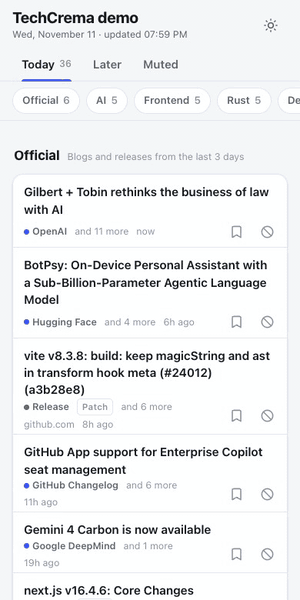
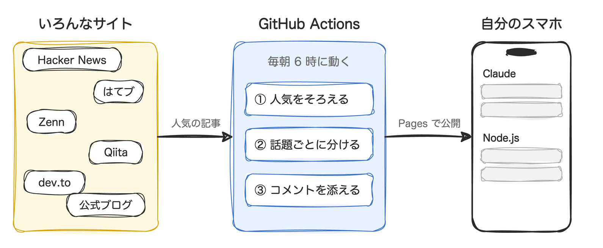

## TL;DR

- Hacker News・はてブ・Zenn・Qiita などから、いま人気で、かつ自分の興味に合う記事だけを 1 日 1 ページにまとめる GitHub Action を作りました
- サーバーと DB は不要です。毎朝 Actions がページを作って GitHub Pages に公開します
- 英語のタイトルはブラウザが翻訳し、記事の下には HN やはてブのコメントの冒頭が 2 件付きます。翻訳 API や AI サービスは使わないので無料です

https://github.com/kamegoro/techcrema

## なぜ作ったのか

技術のキャッチアップ、正直めんどくさくないですか。

Hacker News を開いて、はてブを開いて、Zenn のトレンドを見て、Node.js のリリースノートを確認して…。全部見るとけっこうな時間になります。

ほしかったのは、朝の電車でサーっと眺められる 1 ページでした。NewsPicks の技術版みたいなものです。要約は要りません。各サイトで人気があって、かつ自分が気にしている話題の記事だけが並んでいればいい。Node.js の公式ブログや Claude Code のリリースのような一次情報も、同じページに混ざっていてほしい。

もうありそうだなと思って探したんですが、ちょうどいいものが見つからなかったので作りました。

## どんな画面か

自分用に作っているページです。興味のある話題(自分の場合は Claude・AI・Node.js・E2E・Clojure・Java)ごとに欄があって、上のチップで目次のように飛べます。


触るとこんな感じです(デモページなので英語版です)。



https://kamegoro.github.io/techcrema/

読んだ記事は欄の下に回るので、2 回目に開いたときは残りから読めます。気に入らないサイトやキーワードはその場でミュートできますし、「あとで読む」もあります。こうした状態はブラウザの localStorage に入れていて、どこにも送りません。

## 使い始めてから足したもの

最初はタイトルとリンクを並べるだけでしたが、いざ使ってみると不満が 2 つ出てきました。

### 英語のタイトルが頭に入ってこない

HN や dev.to の記事はタイトルが英語です。日本人の自分には、ぱっと見ても頭に入ってきません。かといって翻訳 API を毎日叩くとお金がかかります。

目を付けたのが、Chrome と Edge に入っている Translator API です。翻訳はブラウザが端末の中でやるので、テキストは外に出ませんし、お金もかかりません。対応していないブラウザでも、タイトルには `lang` 属性を付けてあるので、ブラウザ標準の「翻訳」がそのまま効きます。

### タイトルだけ眺めても知識が増えた気がしない

タイトルを眺めていても、知識が増えている気がしません。開いて読むのも、意外とおっくうでした。

はてブだと、記事そのものよりコメント欄が面白い日もあります。コメントがあればちょっと読んでみたくなるかな、と思って、記事の下に議論から 2 件だけ添えるようにしました。


*この記事のスクショでは、コメント本文と ID をぼかしています*

日本語ページでは、はてブのコメントをはてなスターの多い順に選んでいます。はてブ本体の「人気コメント」とだいたい同じ考え方です。英語の記事なら HN の上位コメントです。どちらも各サイトが公開している JSON から取っています。

ページに出すのはコメントの冒頭だけです。書いた人の ID から元のコメントへ飛べるので、続きが気になったらそのまま元の議論で読めます。

## 工夫したところ

全体の流れはこうなっています。毎朝 1 回 Actions が動いて、できたページを GitHub Pages に置くだけの構成です。



### HN の 300 点とはてブの 300 users は同じではない

サイトごとに人気の桁が違うので、生の点数で並べると大きいサイトばかりが上に来ます。

なので点数は、「そのサイトの直近 14 日の記事のうち、何割より上か」というパーセンタイルに直してから比べています。HN の 300 点も、はてブの 300 users も、そのサイトの中での位置で比べることになります。複数のサイトに同時に載っている記事には、少しだけ加点しています。

### 1 日見なくても取りこぼさない

記事は初めて載った日と次の日の 2 日間ページに残すので、1 日開かなくても見逃しません。その後で人気が大きく伸びた記事は、「再浮上」の印付きで 1 回だけ戻ってきます。

「もう載せた記事」の一覧と 14 日分の点数の履歴は、DB ではなく Actions のキャッシュで次の実行に引き継いでいます。公開されるのはその日の `feed.json` と静的なページだけなので、Actions の無料枠と GitHub Pages で足ります。

## 使い方

公開リポジトリを作って、`.github/workflows/techcrema.yml` を置きます。

```yaml
name: TechCrema
on:
  schedule: [{ cron: '0 21 * * *' }]   # 毎朝 6 時(JST)
  workflow_dispatch:
permissions: { contents: read, pages: write, id-token: write }
jobs:
  publish:
    runs-on: ubuntu-latest
    environment: { name: github-pages, url: '${{ steps.techcrema.outputs.page_url }}' }
    steps:
      - id: techcrema
        uses: kamegoro/techcrema@v1
        with:
          language: ja
          timezone: Asia/Tokyo
          topics: |
            Rust: [rust, cargo]
            Databases: [postgres, sqlite, duckdb]
```

あとは Settings → Pages の Source を「GitHub Actions」にして、Actions タブから一度手動で実行すれば `https://<ユーザー名>.github.io/<リポジトリ名>/` にページができます。

`language: ja` にすると、はてブ・Zenn・Qiita と、はてブで話題になった Speaker Deck・Docswell のスライドが情報源に加わります。`topics` を書くのが面倒なら `presets: frontend, ai` のように用意済みの話題を選ぶこともできます。設定の一覧は [docs/configuration.md](https://github.com/kamegoro/techcrema/blob/main/docs/configuration.md) にあります。

## おわりに

いまは朝の電車でこれを開いています。

https://github.com/kamegoro/techcrema

情報源の追加や UI の翻訳は特に歓迎です。使ってみて気になったところがあれば Issue で教えてください。気に入ったら Star をもらえると励みになります。
